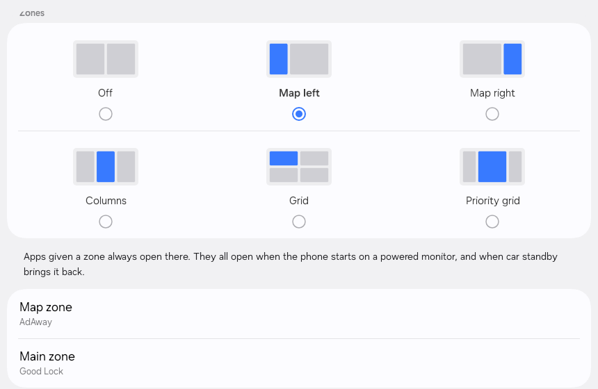
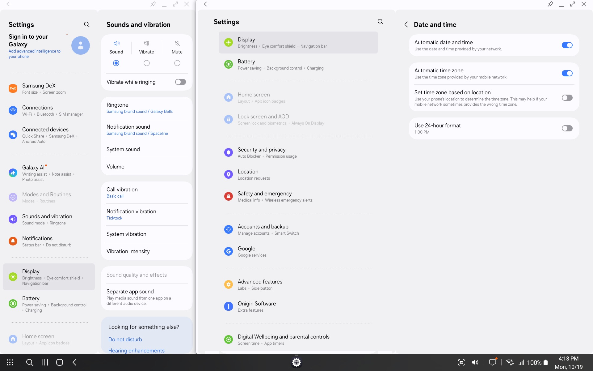
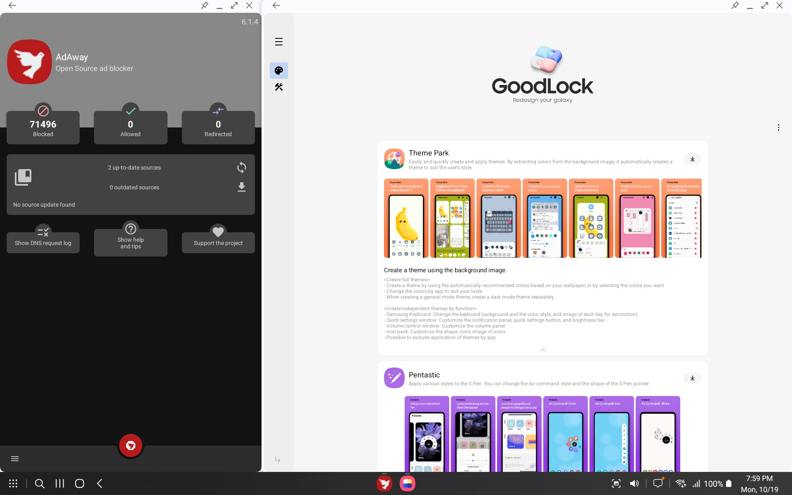
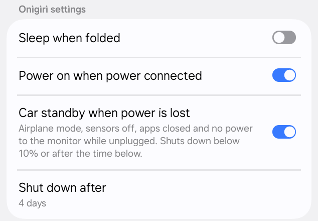
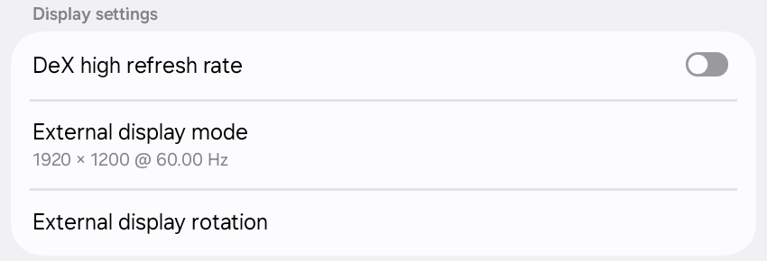

# OnigiriDeX

Onigiri is a custom system for the **Galaxy Z Flip5 (SM-F731B)**. It's built on Android 15 / One UI 7 and takes ideas and code from
[UN1CA](https://github.com/salvogiangri/UN1CA/tree/fifteen) and
[ArtisanROM](https://github.com/ArtisanROM/ArtisanROM).

## What it does

- Runs the whole phone on the **small outside screen** because this uses the software from the **Galaxy Z Fold5**, so the outside screen works like a full phone screen.
- Lets you plug the phone into a monitor and use **Samsung DeX** (a desktop
  mode, like a small computer).
- Can split the DeX desktop into **zones** and open your favourite apps in
  them.
- Can work as a **car screen**: it turns on with the car and sleeps when the
  car turns off.
- Comes with root access (KernelSU + susFS) built in.

## Please read first

**Most of this project was written by AI, and only part of it has been checked
by a person.** The maintainer doesn't have time to review every change.

Installing it can wipe your phone or stop it from starting up. Before you try:

- Back up everything you care about.
- Keep a copy of the original Samsung software so you can go back.

**Use it at your own risk.**

## Extra features

Everything Onigiri adds lives in **Settings → Onigiri Software**. Here's what
each part does.

### DeX zones



Off by default. Zones split the monitor into fixed areas, like a map on one
side and other apps next to it. You can pick a map on the left or right, three
columns, a grid, or a priority grid.

- **Snap windows**: drag a window to the edge of the screen and it fills the
  zone there.
- **New windows** open in the main zone.
- **Zone apps**: pick an app for each zone. It opens in its zone every time it
  starts, and all of them open by themselves when the phone starts on a
  monitor (handy in the car). Each app can only have one zone.





### Phone settings



- **Power on when power connected**: when the phone is off and gets power, it
  turns on by itself once the battery reaches 5%.
- **Car standby when power is lost**: when the car turns off, the phone waits
  a minute and then goes into a deep sleep to save battery. It turns on
  airplane mode, turns off Wi-Fi, Bluetooth and location, closes apps and
  stops powering the monitor. It checks every 30 seconds whether the car is
  back (less often after a long time, or right away if you press the power
  button), and turns everything back on when it is. If the car stays off for
  4 days, or the battery drops below 10%, the phone shuts down.

### Monitor settings



- **External display mode**: pick the resolution and refresh rate for your
  monitor. The list shows what your monitor supports. Unplug and plug the
  cable back in after changing it. Choose **Automatic** to go back to the
  monitor's default.
- **External display rotation**: turns the desktop on the monitor. It changes
  right away.
- **DeX high refresh rate** (experimental, off by default): lets the desktop
  run smoother than 60 frames per second on fast monitors. In testing, a
  144 Hz monitor reached about 142 frames per second instead of 60. Unplug and
  plug the cable back in after turning it on. Some apps may still run slower,
  and it may stay at 60 while the phone's own screen is on. Battery saver and
  overheating protection still work as usual.

<details>
<summary><b>Boring stuffs</b></summary>

- **Allow secure screenshot**: lets you take screenshots in apps that normally
  block them.
- **Disable screenshot detection**: apps are no longer told when you take a
  screenshot.
- **Unlock higher FPS in games**: some games only offer their smoothest
  settings on certain phones. This makes them think you have one of those
  phones.
- **Hide developer status from apps**: some apps, often banking apps, refuse
  to work when developer options are turned on. This hides it from them.
- **Sleep when folded**: turns the screen off and locks the phone when you
  close it.
- **Play Integrity Fix**: helps apps that check whether your phone has been
  changed, like Google Wallet or banking apps, keep working. The date shows
  which version you have. Tap the name to check for a newer one.
- **Play power on sound effect**: plays Samsung's sound when the phone starts.
  Off by default.
- **Enable live blur effect**: gives menus and panels a frosted-glass look.
  The phone needs a restart after you change it.
- **Allow application downgrade**: lets you install an older version of an
  app over a newer one.
- **Disable low target SDK block**: lets you install very old apps that
  Android 15 normally refuses.
- **Disable ASKS**: turns off a Samsung security check that can stop some
  apps from installing or running.

</details>

## Building it yourself

You need a Linux computer with Bash, Python 3 and Java 17.

**1. Get the code and tools**

```sh
git clone --recurse-submodules https://github.com/Kinue72/zflip5-dex.git
cd zflip5-dex
bash
source ./buildenv.sh SM-F731B
onigiri build_dependencies
```

**2. Download the original Samsung software**

Put these full firmware ZIP files in the `firmware/` folder:

- Flip5: SM-F731B / XXV / F731BXXS5EYI1
- Fold5: SM-F946B / XXV / F946BXXS5EYI1
- Galaxy S24 (only used for screen colours): SM-S921B / S921BXXS9BYH1

**3. Build**

Change the file names below to match the files you downloaded:

```sh
python3 scripts/import_fw.py target firmware/flip5.zip
python3 scripts/import_fw.py donor firmware/fold5.zip
onigiri extract_fw
onigiri extract_fw --ignore-source --ignore-target SM-F946B/XXV
python3 scripts/extract_adaptive_display.py firmware/s24.zip
source ./buildenv.sh SM-F731B
onigiri build_kernel
onigiri make_rom
onigiri build_odin
```

The finished files show up in the `out/` folder.

**4. Install it on the phone**

Follow [docs/flashing.md](docs/flashing.md). It covers odin4 on Linux and
macOS (tested) and Odin on Windows (not tested yet).

A few things to keep in mind:

- The build creates a private key at `security/onigiri_platform.pk8`. Keep it
  safe, don't share it, and use the same one for every future update.
- Only install the Flip5's own low-level parts (bootloader, modem and
  hardware files). Never put Fold5 ones on the phone.
- Parts of the build are made for this exact Samsung software version. If you
  use a newer version, the build will stop on purpose so nothing breaks
  quietly.

## For contributors

The kernel (the core of the system) comes from
[GoRhanHee's kernel](https://github.com/GoRhanHee/android_kernel_samsung_sm8550) and lives in `external/kernel`. Our own changes are kept as numbered patch
files in `external/patches/kernel/`. The build adds them in and removes them
again when it's done. Please put your kernel changes there and leave
`external/kernel` itself untouched.

## Help and feedback

Found a problem or have an idea? [Open an issue](https://github.com/Kinue72/zflip5-dex/issues) or [send a pull request](https://github.com/Kinue72/zflip5-dex/pulls).

See [LICENSE](LICENSE) and [NOTICE](NOTICE) for license and credits.
